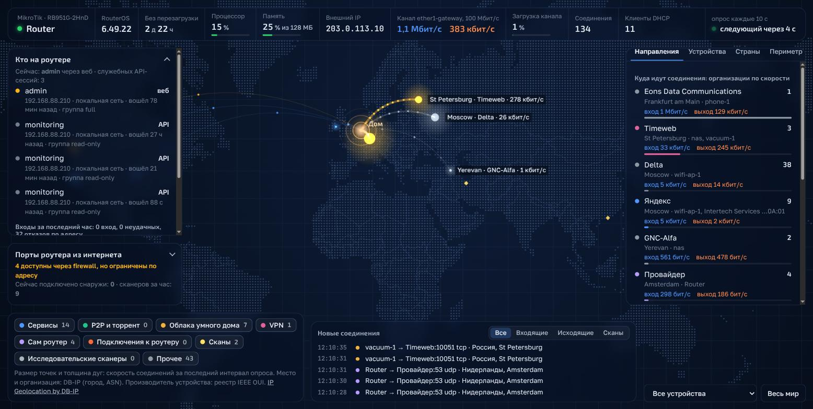

# Dashboards

Набор самостоятельных дашбордов для домашней и небольшой офисной инфраструктуры.
Все написаны на Python 3.9+ только со стандартной библиотекой: ставить пакеты через `pip` не нужно.
Веб-дашборды отдают интерфейс из того же процесса, `linux-tui` работает в терминале.

Проекты реализованы с помощью [Claude Code](https://claude.com/claude-code).

| Проект | Что показывает | Источник данных | Где открывать |
| --- | --- | --- | --- |
| [`zabbix/`](zabbix/) — **Zabbix Galaxy** | 3D-галактика хостов: планеты, состояние, метрики, проблемы, порты роутеров, службы | Zabbix API | `127.0.0.1:8080` |
| [`mikrotik-api/`](mikrotik-api/) — **MikroTik connection map** | Карта мира с соединениями роутера, входящие сканы, открытые порты, сессии на роутере | RouterOS API | `127.0.0.1:8787` |
| [`openwrt-api/`](openwrt-api/) — **OpenWrt connection map** | Та же карта для роутера на OpenWrt | ubus поверх HTTP | `127.0.0.1:8787` |
| [`linux-api/`](linux-api/) — **Linux connection map** | Карта соединений Linux-роутера или сервера: соединения, сканы, порты из интернета, входы по SSH, клиенты VPN | conntrack, `ss`, iptables на самой машине | `127.0.0.1:8787` |
| [`linux-tui/`](linux-tui/) — **Linux connections in a terminal** | Данные `linux-api` таблицами в терминале | та же машина или работающий `linux-api` | терминал |

Проекты не зависят друг от друга: у каждого свои настройки и свой README.
У трёх карт соединений один порт по умолчанию, `8787`. Чтобы запустить несколько карт на одной
машине, задайте им разные `http_port` в `.env`.

## Zabbix Galaxy


Каждый хост Zabbix — планета. Цвет и узор планеты зависят от ОС, пояс — от состояния хоста,
размер — от выбранной метрики. Роутеры (MikroTik, OpenWrt) нарисованы орбитальными станциями
с портами. Новые проблемы подсвечиваются на сцене и во всплывающих уведомлениях.

```bash
cd zabbix
cp .env_example .env && chmod 600 .env   # адрес Zabbix и API-токен
python3 server.py                        # или: docker compose up -d --build
```

Подробности: [zabbix/README.md](zabbix/README.md) (на английском).

## MikroTik connection map



Живая карта соединений роутера MikroTik: трафик к городам и организациям, подключения к
роутеру и сканы из интернета, сервисы, доступные с WAN, активные сессии и состояние роутера.

```bash
cd mikrotik-api
cp .env.example .env                     # адрес роутера и пользователь API только для чтения
./start.sh                               # Windows: start.bat; или: docker compose up -d --build
```

Подробности: [mikrotik-api/README.md](mikrotik-api/README.md).

## OpenWrt connection map

Карта соединений для роутера на OpenWrt. Данные читаются по ubus поверх HTTP, напрямую или через
HTTP-прокси. На роутер ставится короткий скрипт, файл прав «только чтение» и пользователь `rpcd`.
Сам сервис работает на любой машине, которая видит роутер, в том числе на Windows.
Проверено на Xiaomi AX3000T с OpenWrt 23.05.5.

```bash
cd openwrt-api
cp .env.example .env                     # адрес роутера, пользователь, пароль, прокси
python3 check.py                         # проверка настройки роутера; Windows: check.bat
./start.sh                               # Windows: start.bat
```

Настройка роутера: [openwrt-api/ROUTER-SETUP.md](openwrt-api/ROUTER-SETUP.md).
Подробности: [openwrt-api/README.md](openwrt-api/README.md).

## Linux connection map

Сервис работает на самой Linux-машине: читает conntrack, сокеты, интерфейсы и правила iptables.
Два режима: `mode=router` для машины с WAN и LAN за NAT и `mode=host` для одиночного сервера,
обычно в облаке. Нужен root. Запускается вручную, как служба systemd или в Docker.

```bash
sudo apt install python3 conntrack
cd linux-api
cp .env.example .env                     # режим, WAN, LAN, где слушать карту
sudo ./start.sh                          # или служба linux-map.service, или docker compose up -d --build
```

На облачном сервере оставьте `127.0.0.1` и откройте карту через туннель:
`ssh -L 8787:127.0.0.1:8787 user@server`.
Подробности: [linux-api/README.md](linux-api/README.md).

## Linux connections in a terminal

Терминальный вариант `linux-api` на `curses`: соединения, сервисы, доступные из интернета, входы по SSH.
Удобно, когда на сервер зашли по SSH и браузера под рукой нет.

```bash
cd linux-tui
sudo ./start.sh                          # собирать данные на этой машине (нужен root)
./start.sh --url http://127.0.0.1:8787   # показывать данные работающего linux-api, root не нужен
```

Подробности: [linux-tui/README.md](linux-tui/README.md).

## Справочные базы

Карты соединений и `linux-tui` при первом запуске скачивают базы геолокации DB-IP и реестр
производителей IEEE OUI (около 95 МБ) и около минуты строят их кэш. Базы и кэш не попадают в git.
`start.sh --update` обновляет базы до свежего месяца.

IP Geolocation by DB-IP (https://db-ip.com), CC BY 4.0.

## Безопасность

- Файлы `.env` и `names.conf` содержат учётные данные и имена ваших устройств. Они не попадают в git.
  В репозитории лежат только примеры: `.env_example`, `.env.example` и `names.conf.example`.
- У дашбордов нет своей авторизации. По умолчанию они слушают только `127.0.0.1`.
  Адрес `0.0.0.0` используйте только в доверенной сети или за обратным прокси с авторизацией.
- Для Zabbix, MikroTik и OpenWrt нужен пользователь только с правами на чтение. Как его создать,
  описано в README каждого проекта.
- `linux-api` и `linux-tui` в режиме сбора работают от root. Они ничего не меняют в системе,
  кроме `net.netfilter.nf_conntrack_acct=1` при `conntrack_acct=on`.

## Лицензия

Все проекты распространяются по лицензии MIT, см. [LICENSE](LICENSE).

---

## English

A set of standalone dashboards for home and small-office infrastructure. All of them need Python 3.9+
and nothing beyond the standard library: there is nothing to install with `pip`. The web dashboards
serve their interface from the same process; `linux-tui` runs in a terminal.

The projects were built with [Claude Code](https://claude.com/claude-code).

| Project | What it shows | Data source | Where to open |
| --- | --- | --- | --- |
| [`zabbix/`](zabbix/) — **Zabbix Galaxy** | A 3D galaxy of hosts: planets, health, metrics, problems, router ports, services | Zabbix API | `127.0.0.1:8080` |
| [`mikrotik-api/`](mikrotik-api/) — **MikroTik connection map** | A world map of router connections, inbound scans, WAN-exposed ports, sessions on the router | RouterOS API | `127.0.0.1:8787` |
| [`openwrt-api/`](openwrt-api/) — **OpenWrt connection map** | The same map for an OpenWrt router | ubus over HTTP | `127.0.0.1:8787` |
| [`linux-api/`](linux-api/) — **Linux connection map** | A connection map of a Linux router or server: connections, scans, internet-facing ports, SSH logins, VPN clients | conntrack, `ss`, iptables on the machine itself | `127.0.0.1:8787` |
| [`linux-tui/`](linux-tui/) — **Linux connections in a terminal** | The `linux-api` data as tables in a terminal | the same machine or a running `linux-api` | terminal |

The projects do not depend on each other. Each one has its own settings and its own README
(the connection maps are documented in Russian). The three connection maps share the default port
`8787`: to run several of them on one machine, give each one its own `http_port` in `.env`.

### Zabbix Galaxy

Every Zabbix host is a planet. Its colour and pattern show the OS, its belt shows the host health,
and its size follows a metric you choose. Routers (MikroTik, OpenWrt) are orbital stations with
their ports around them. New problems flare on the scene and appear as toasts.

```bash
cd zabbix
cp .env_example .env && chmod 600 .env   # Zabbix URL and API token
python3 server.py                        # or: docker compose up -d --build
```

Details: [zabbix/README.md](zabbix/README.md).

### MikroTik connection map

A live map of a MikroTik router's connections: traffic to cities and organisations, connections to
the router and scans from the internet, services reachable from the WAN, active sessions and router
health.

```bash
cd mikrotik-api
cp .env.example .env                     # router address and a read-only API user
./start.sh                               # Windows: start.bat; or: docker compose up -d --build
```

Details: [mikrotik-api/README.md](mikrotik-api/README.md).

### OpenWrt connection map

A connection map for an OpenWrt router. Data is read over ubus on HTTP, directly or through an HTTP
proxy. The router gets a short script, a read-only ACL file and an `rpcd` user. The service itself
runs on any machine that can reach the router, Windows included. Tested on a Xiaomi AX3000T with
OpenWrt 23.05.5.

```bash
cd openwrt-api
cp .env.example .env                     # router address, user, password, proxy
python3 check.py                         # check the router setup; Windows: check.bat
./start.sh                               # Windows: start.bat
```

Router setup: [openwrt-api/ROUTER-SETUP.md](openwrt-api/ROUTER-SETUP.md).
Details: [openwrt-api/README.md](openwrt-api/README.md).

### Linux connection map

The service runs on the Linux machine itself and reads conntrack, sockets, interfaces and iptables
rules. Two modes: `mode=router` for a machine with WAN and LAN behind NAT, and `mode=host` for a single
server, usually in a cloud. It needs root. Run it by hand, as a systemd service or in Docker.

```bash
sudo apt install python3 conntrack
cd linux-api
cp .env.example .env                     # mode, WAN, LAN, where to serve the map
sudo ./start.sh                          # or linux-map.service, or docker compose up -d --build
```

On a cloud server keep `127.0.0.1` and open the map through a tunnel:
`ssh -L 8787:127.0.0.1:8787 user@server`.
Details: [linux-api/README.md](linux-api/README.md).

### Linux connections in a terminal

A `curses` version of `linux-api`: connections, internet-facing services, SSH logins. Handy when you
are on a server over SSH and have no browser at hand.

```bash
cd linux-tui
sudo ./start.sh                          # collect data on this machine (needs root)
./start.sh --url http://127.0.0.1:8787   # show the data of a running linux-api, no root needed
```

Details: [linux-tui/README.md](linux-tui/README.md).

### Reference databases

On the first start the connection maps and `linux-tui` download the DB-IP geolocation databases and
the IEEE OUI registry (about 95 MB) and spend about a minute building their cache. The databases and
the cache stay out of git. `start.sh --update` updates the databases to the latest month.

IP Geolocation by DB-IP (https://db-ip.com), CC BY 4.0.

### Security

- `.env` and `names.conf` files hold credentials and the names of your devices. They stay out of git.
  Only the examples are committed: `.env_example`, `.env.example` and `names.conf.example`.
- The dashboards have no login of their own and listen on `127.0.0.1` by default. Use `0.0.0.0`
  only in a trusted network or behind a reverse proxy with authentication.
- Zabbix, MikroTik and OpenWrt need a read-only user. Each project's README shows how to create one.
- `linux-api` and `linux-tui` in collector mode run as root. They change nothing in the system except
  `net.netfilter.nf_conntrack_acct=1` when `conntrack_acct=on`.

### License

All projects are released under the MIT License, see [LICENSE](LICENSE).
