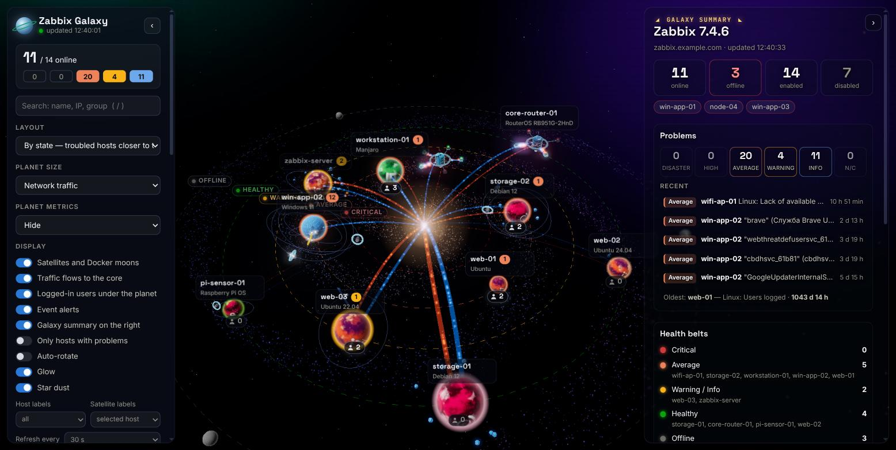
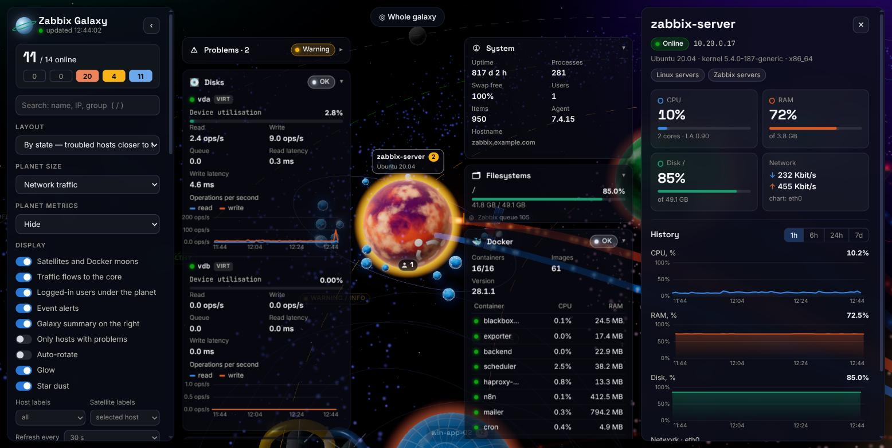
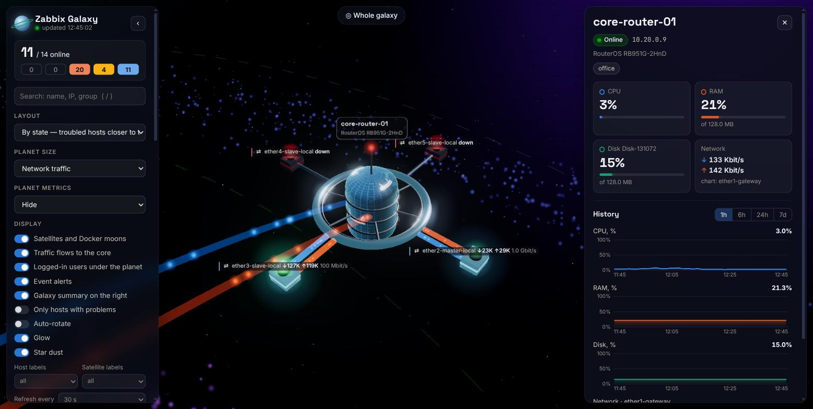

# Zabbix Galaxy

A 3D dashboard for Zabbix hosts. Each host is a planet in a dark galaxy.



| Host view: metric cards, disks, Docker moons, history | Router as an orbital station with port segments |
| --- | --- |
|  |  |

Screenshots use anonymized host names, addresses and container names.

- **Planet surface** shows the OS: Windows is blue with a pane grid, Ubuntu orange, Debian crimson with a spiral,
  Raspberry Pi OS raspberry-red, Manjaro green, other Linux yellow. The backend detects the distribution from
  `system.sw.os` and `system.uname`. For hosts without data it guesses from the host name and groups.
- **Layout "по состоянию"** (default): hosts sit on dashed belts around the core, worst health inside:
  critical (High, Disaster) → Average → Warning/Info → healthy, and unreachable hosts on an outer "Нет связи" belt
  beyond all orbits. Every live host gets its own angular slot, so no planet sits on another host's traffic lane.
  When a host's state changes it glides to its new belt (the camera follows if it is the focused host).
- **Unreachable hosts** are grey, lifeless planets: no rings, satellites, moons, traffic, user badge or red pulsing;
  their label appears on hover only. "Свободная
  галактика" keeps the old stable random placement.
- **Network devices over SNMP** (e.g. the "Mikrotik by SNMP" template): the backend reads SNMP-style keys
  (`system.cpu.util[hrProcessorLoad.N]`, `vm.memory.util[...]`, `vfs.fs.pused[hrStorageSize.N]`,
  `system.hw.uptime[...]`, IF-MIB `net.if.*[ifHCInOctets.N]` grouped by ifIndex with status, speed, type and
  errors). RouterOS gets its own planet (blue, pane grid, router emblem) detected from `sysDescr`. Bridges and
  tunnels count as virtual ports; when a port name marks an uplink (gateway, wan, pppoe, lte ...) the host's traffic is
  that uplink only, so LAN traffic switched between ports is not counted twice (the uplink is the flow to the core).
  Every physical LAN port is a moon linked to the router by two side-by-side glowing lanes, styled like the flows to
  the core: blue with particles flying to the router (received on the port) and orange flying to the moon (sent).
- **Routers are orbital stations, not planets**: any host with a ports satellite (MikroTik, OpenWrt) is drawn as a
  hub painted with its OS style, a rotating docking ring, spokes and a mast with a beacon. Each LAN port is a segment
  placed symmetrically around the station: a port with traffic hangs on its two lanes (blue in, orange out) and blinks
  green; a port without traffic sits on a translucent strut (green light if up, fast red blink if down, grey if
  unknown). Alarms tint the ring red. The port "moons" described below are these segments.
- **OpenWrt routers with the Zabbix agent** ("Linux by Zabbix agent"): detected from `system.sw.os`
  (cyan planet with a wireless emblem). Ports come from `net.if.in/out["lanN"|"wan"]` plus
  `vfs.file.contents["/sys/class/net/<if>/operstate|speed"]`: switch ports and Wi-Fi APs (`phyN-apN`) are moons,
  `wan` is the uplink, and `eth0` (the DSA CPU port) and tunnels are left out. Flash partitions
  (`mtdblock*`, `ubiblock*`) are hidden from the disk card.
  Each lane's width follows its own direction's traffic; particle count and speed grow with it, and particles keep a
  fixed on-screen size so they stay visible from afar. The moon's colour and glow grow with the traffic too. A port without traffic, or down, is a grey lifeless moon that keeps orbiting.
  Hover a port moon for its name, traffic and speed; click it for the "Ports" card (ICMP ping, response time, loss,
  and every port with link state, speed, traffic and errors).
- **Planet size** follows a setting you choose. The default is disk fill on `/` or `C:`.
- **Metric card** above each planet shows CPU, RAM and disk as bars with numbers. A value at 80% or more turns yellow,
  at 90% or more red. Rings are still available in the settings. Overlapping cards shrink to the name, or hide in favour
  of more important hosts.
- **Event alerts**: when a new problem appears or the number of logged-in users grows, the planet flares in the
  event colour, a dashed ring rotates around it and shrinks as the 3 minutes run out, and the host's name card is
  tinted with the event colour; everything fades together. A translucent toast in the top-right corner shows the host, the
  problem, OS, IP, CPU/RAM/disk and users, with a 3-minute countdown bar. High and Disaster problems keep their toast
  (pulsing, alarm colour) until the problem is resolved, and the planet pulses red. On page load, Average-and-lower
  problems younger than 3 minutes are shown; High and Disaster are always shown. Click a toast to fly to the host;
  × hides the toast (the planet keeps pulsing). While a host is open the toasts collapse into a "🔔 N" pill (red and
  pulsing if there is a High/Disaster alarm) so they do not cover the cards; click it to expand.
  Preview with `?demo=alerts` (synthetic events on real hosts).
- **Galaxy summary** (transparent right overlay in the overview — planets stay visible through it; collapses to a
  narrow strip of key numbers with its › button; hidden while a host is open): Zabbix version and server, hosts
  online / unreachable (named) / enabled / disabled, problems by severity, the five newest problems and the oldest
  one, hosts per health belt, top 3 by CPU, RAM and disk, galaxy traffic and top talkers, Docker / PostgreSQL / 1C,
  users logged in on hosts, item count, items with errors and the queue. Click any host in it to fly there.
  Web-interface users appear only if an item with key `zabbix.web.users.online` exists (e.g. a DB monitor item on
  the Zabbix server: `SELECT count(*) FROM sessions WHERE status=0 AND lastaccess > extract(epoch from now())-300`),
  or set `GALAXY_WEB_USERS_KEY`.
- **Logged-in users**: a badge under each planet shows how many users are logged in (`system.users.num` on Linux,
  the custom `rdps` RDP-session item on Windows where it exists). Zero is shown dimmed; hosts without fresh data
  have no badge. Toggle it in the left panel.
- **Traffic flows**: two lanes link each planet to the galactic core. Blue particles fly in (inbound), orange ones
  fly out to the core (outbound). Width, particle count and speed follow a log scale relative to the quietest and
  busiest host, so the difference between hosts is easy to see. The core is a conventional "outside world": Zabbix
  does not know which hosts talk to each other. The metric card also has ↓/↑ rows (absolute log scale), and
  "Сетевой трафик" is available as a planet size mode.
- **Docker moons**: each container is a small moon. Its size follows memory use and its glow follows CPU. A stopped
  container is red and almost still. Hover a moon to see its name and load. Click it to open the container row.
- **Halo** shows the worst active problem. Red means the agent is unreachable.
- **Artificial satellites** are other services found on the host: MySQL (teal; the host's main service, so a
  bigger craft on the innermost orbit), PostgreSQL (blue body), 1C (yellow),
  S.M.A.R.T. (silver), services (gold), Zabbix server (red). On Windows only PostgreSQL and 1C services count
  (the `GALAXY_WIN_SERVICES` environment variable overrides the pattern). Linux systemd/service items are kept. Each has a body, solar panels and a dish antenna, and a
  beacon that blinks slowly green when the service is fine and quickly yellow or red when it has problems.
  The API user cannot read templates, so the backend infers services from item keys.
- **Click** a planet to fly to it. The right panel shows the essentials: KPIs and charts (1h, 6h, 24h, 7d).
  Everything else floats as translucent cards on both sides of the planet: problems, system facts, disks (I/O load
  plus S.M.A.R.T.: temperature, power-on hours, self-test, reallocated or uncorrectable sectors, NVMe wear and media
  errors; virtual disks such as vda/vdb are tagged VIRT, since a hypervisor exposes no SMART, and show utilisation,
  read/write operations, latencies, queue and an operations chart), filesystems, Docker, PostgreSQL, 1C, services and
  network interfaces. Click a card header to collapse it;
  the choice is remembered. On screens narrower than 1200 px the cards move into the right panel.
  Press Esc, click empty space or use "Вся галактика" to return. A click that just misses a moving moon or
  satellite (within 30 px) still counts as a click on it.
- **Service window** for MySQL, PostgreSQL and 1C opens over everything, either from the "Все метрики" button on the
  card or by clicking the satellite. Direct link: `#host=<id>&svc=mysql`, `&svc=postgresql` or `&svc=1c`.
  - MySQL (template "MySQL by Zabbix agent 2"): status, version, uptime, connected / running threads, queries and
    slow queries per second, buffer pool hit ratio and fill, row-lock waits, tmp tables on disk, aborted connections,
    traffic; commands by type; charts (queries, commands, threads, buffer pool hit, traffic, connections, slow
    queries, tmp tables, lock waits); database sizes with their share; InnoDB, thread/table and connection-error
    details.
  - PostgreSQL: health tiles (availability, role, connections, cache hit, commits, deadlocks, idle in transaction,
    oldest xid, autovacuum, WAL, archiving), connections by state, charts (connections, transactions, commits per
    database, cache hit, row reads and writes, blocks, bgwriter, temp files), a per-database table with an expandable
    row per database (locks by type, slow queries, I/O), checkpoint, replication and WAL details, and the list of
    items that fail to collect together with the Zabbix error.
  - 1C: totals, then one panel per infobase (the `infobase` tag): sessions by client type, 5-minute load (calls,
    CPU, call and DBMS time, memory), traffic, lock waits, longest current call, and charts. Cluster-level items
    from the older template are listed with their state (for example, "Unsupported item key").
- **Disabled hosts** are not shown.

## Run

```bash
cp .env_example .env && chmod 600 .env       # every setting is described in .env_example
python3 server.py                            # settings from .env (default 127.0.0.1:8080)
python3 server.py env_uk                     # settings from .env_uk (also accepts .env_uk or a path)
python3 server.py --port 9000 --host 0.0.0.0 # flags override the settings file
```

### Docker

```bash
docker compose up -d --build            # both dashboards: galaxy (.env, :8080) and galaxy-uk (.env_uk, :8090)
docker compose up -d galaxy             # only one of them
```

Settings reach the container in one of three ways, all shown in `docker-compose.yml`:

1. `env_file: .env` — the settings file becomes environment variables (the default services);
2. a read-only mount, `./.env_uk:/app/.env_uk:ro`, plus `command: ["env_uk"]` (service `galaxy-uk-mounted`,
   started with `--profile mounted`);
3. `environment:` values in the compose file or taken from the shell.

Plain `docker run` works the same way: `--env-file .env`, or `-v "$PWD/.env:/app/.env:ro"`, or `-e KEY=VALUE`.
Settings files are excluded from the image (`.dockerignore`). Inside the container the server always listens on
`0.0.0.0:8080`; publish it with `ports:` / `-p`. The compose file binds to `127.0.0.1` because the dashboard has no
login. The image runs as an unprivileged user and has a health check on `/api/config`. A proxy such as
`192.168.x.x` must be reachable from the container network.

The settings files use `KEY=VALUE` lines, the format docker compose reads (it also loads `.env` automatically for
interpolation, so that file must stay in this format). Avoid `$` in values, or double it (`$$`). The older
`"KEY": "value"` fragment is still accepted by `server.py` for runs without Docker.

Requires Python 3.9 or later and no third-party packages. The browser loads Three.js from jsdelivr and fonts
from Google Fonts, so it needs internet access.

Credentials and the listen address come from `.env`, as `KEY=value` lines (preferred, docker-compatible) or as
`"KEY": "value"` pairs.
Real environment variables override `.env`, and command-line flags override both:

```
ZABBIX_URL=https://zabbix.example.com
ZABBIX_USER=api-user
ZABBIX_PASSWORD=secret
# or instead of user/password:
# ZABBIX_TOKEN=...
GALAXY_HOST=127.0.0.1   # listen address; 0.0.0.0 exposes the dashboard to the network without a login
GALAXY_PORT=8080        # listen port
ZABBIX_PROXY=           # optional: http://[user:pass@]proxy:3128 for Zabbix API calls; empty = direct
GALAXY_LANG=ru          # interface language: ru (default) or en
GALAXY_SERVICES=        # important OS services, e.g. postgres,1C,nginx (see below); empty = default view
```

`GALAXY_SERVICES` is a comma-separated list of case-insensitive substrings matched against a host's service
names and descriptions (Windows `service.info`, `systemd.unit.info`, `service.status`). Every match becomes its
own satellite, a slightly larger "station" with a rotating ring and its own status beacon. The remaining services
keep the aggregate "Службы" satellite only when there are 5 or fewer of them; with more (typical on Windows) that
satellite is not drawn. The services card always lists everything, important services first with a star. The list also matches the
services found from templates (MySQL, PostgreSQL, 1C, Docker, Zabbix; `pgsql`/`postgres` match PostgreSQL,
`mariadb` matches MySQL): a matching one is drawn as a station in its own colour instead of the usual satellite. When
the parameter is empty, only PostgreSQL and 1C services count on Windows and all services share one satellite.

## Structure

- `server.py` logs in to Zabbix, caches data for 25 s and serves the JSON API and the static files.
  - `GET /api/overview` returns all hosts with metrics, problems and satellites.
  - `GET /api/host/<id>` returns details for one host.
  - `GET /api/history/<id>?period=3600` returns CPU, RAM, disk, network and load series. It uses `history.get`
    for periods up to 2 days and `trend.get` for longer periods.
  - `GET /api/service/<id>/postgresql|1c?period=3600` returns every item of that service, grouped by database or
    infobase, together with history series.
- `web/` contains the frontend: `index.html`, `style.css`, and in `js/` the Three.js scene (`scene.js`),
  OS styles and emblems (`os.js`), interface language (`i18n.js`: an English dictionary applied to the rendered
  DOM by exact phrase match, so Zabbix data such as host names and problem texts is never altered; phrases that
  mix words and numbers use `tr(ru, en)` in place), the detail panel (`panel.js`), the PostgreSQL/1C window (`service.js`), the app shell (`main.js`) and helpers (`util.js`).
