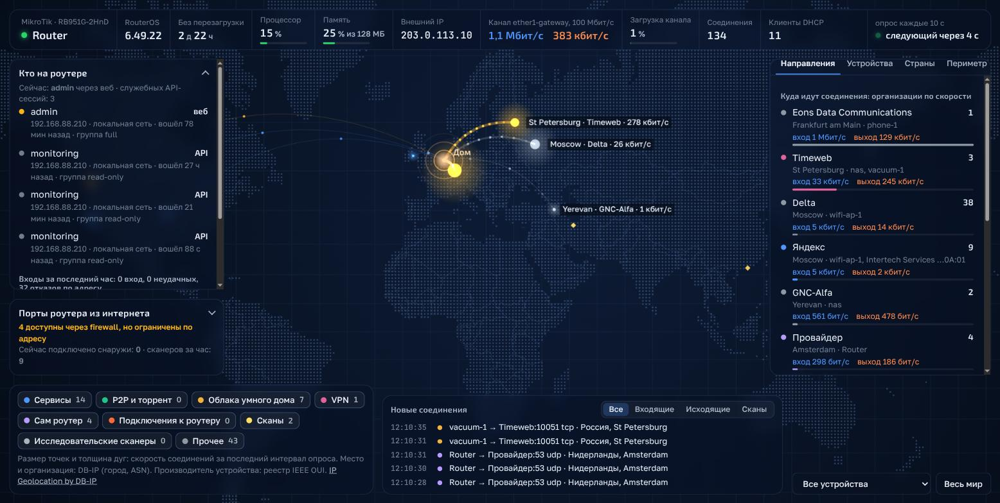
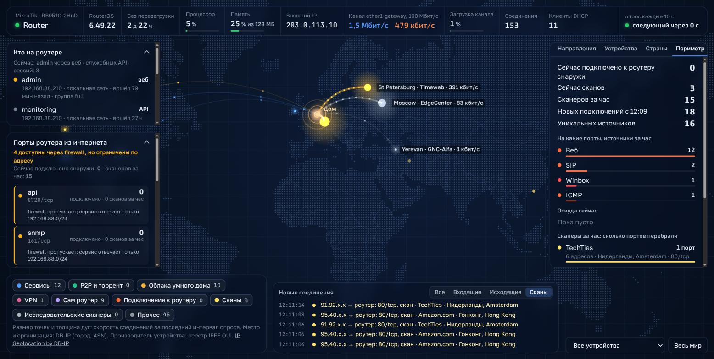

# MikroTik connection map

Живая карта мира со всеми соединениями роутера MikroTik: куда ходят устройства дома, что
делает сам роутер и кто стучится на него из интернета. Данные берутся напрямую из RouterOS API,
без Prometheus, агентов и баз данных.

- **Трафик** — дуги от дома к городам и организациям, с кем сейчас есть соединения; толщина и
  плотность пакетов по реальной скорости (байты из conntrack).
- **Входящие** — отдельно подключения к роутеру и сканы; известные исследовательские сканеры
  (Censys, Shodan и подобные) выделены.
- **Порты из интернета** — какие сервисы роутера доступны с WAN: вывод по `/ip service`,
  правилам firewall и спискам «Available From».
- **Кто на роутере** — активные сессии (веб, Winbox, SSH, API), неудачные входы и отказы по адресу
  из журнала роутера.
- **Состояние роутера** — версия, аптайм, CPU, память, внешний IP, скорость и загрузка канала,
  туннели.





*Скриншоты обезличены: адреса локальной сети, внешний IP, имена устройств и местоположение заменены.*

Сервис — один процесс на Python 3.9+ только со стандартной библиотекой: ничего устанавливать не
нужно. Работает на Linux, macOS, Windows и в Docker. Проверен на RouterOS 6.49; команды и API
совместимы с RouterOS 7.

## Быстрый старт

1. Создайте на роутере пользователя API только для чтения — см. [Пользователь API](#пользователь-api-на-mikrotik).
2. Скопируйте `.env.example` в `.env` и впишите адрес роутера, логин и пароль.
3. Запустите:
   - Linux, macOS: `./start.sh` (или `python3 start.py`);
   - Windows: двойной щелчок по `start.bat`;
   - Docker: `docker compose up -d --build`.
4. Откройте http://127.0.0.1:8787.

При первом запуске скачиваются справочные базы (около 95 МБ) и один раз строится их кэш
(около минуты). Дальше старт мгновенный. В окне запуска появляется адрес карты:

```
=======================================================
  Карта: http://127.0.0.1:8787  — откройте в браузере
  Остановить: Ctrl+C
=======================================================
```

## Пользователь API на MikroTik

Сервису нужен отдельный пользователь только на чтение. Команды для терминала RouterOS
(Winbox → New Terminal или SSH). В примерах роутер `192.168.88.1`, локальная сеть
`192.168.88.0/24`, машина с сервисом `192.168.88.10` — замените на свои.

1. Группа с правами только на чтение по API:

   ```
   /user group add name=map-read policy=read,api comment="Map service: read-only API"
   ```

   Права, не перечисленные в `policy`, выключены. Не давайте `write`, `policy` и `sensitive`:
   без них пользователь ничего не изменит и не увидит пароли и ключи в конфигурации.

2. Пользователь, которому разрешён вход только с адреса машины с сервисом (или прокси, если
   сервис ходит через него):

   ```
   /user add name=map-api group=map-read address=192.168.88.10/32 password="длинный-случайный-пароль" comment="Map service"
   ```

3. Сервис API включён и доступен с этого адреса:

   ```
   /ip service print detail where name=api
   /ip service set api disabled=no address=192.168.88.0/24
   ```

   Если в `address` уже есть сети, добавьте свою через запятую, не удаляя остальные.
   Сервис использует обычный API на порту 8728 (без SSL), поэтому ограничение по адресу
   обязательно, а с WAN порт 8728 должен быть закрыт в firewall.

4. Данные в `.env`:

   ```
   server_api=192.168.88.1
   username_api=map-api
   password_api="длинный-случайный-пароль"
   ```

5. Проверка: после запуска в журнале сервиса появляются строки `config: WAN ...` и
   `poll: N connections`. Ошибка `login failed` — неверный логин или пароль либо адрес машины
   не входит в `address` пользователя или сервиса `api`.

Отозвать доступ: `/user remove map-api` и `/user group remove map-read`.

## Настройки

Все настройки — в `.env` рядом с сервисом (шаблон с пояснениями: `.env.example`; сам `.env`
в git не попадает). Любой ключ можно переопределить переменной окружения в верхнем регистре,
например `POLL_INTERVAL=10 python3 server.py`. Комментарии в `.env` — только отдельной строкой.

| Ключ | По умолчанию | Что это |
|---|---|---|
| `server_api` | — | адрес роутера (как его видит машина с сервисом или прокси) |
| `port_api` | 8728 | порт API |
| `username_api`, `password_api` | — | пользователь API с правами `read` и `api` |
| `proxy` | пусто | `host:port` HTTP-прокси с методом CONNECT, если роутер доступен только через него |
| `poll_interval` | 30 | секунд между опросами (минимум 5) |
| `poll_mode` | always | `always` — опрашивать всё время; `clients` — только пока карта открыта в браузере |
| `idle_timeout` | 300 | для `clients`: через сколько секунд после закрытия последней вкладки остановить опрос |
| `config_interval` | 300 | секунд между перечитыванием сервисов и правил firewall |
| `wan_interface` | пусто | WAN-интерфейс; пусто — определяется по DHCP-клиенту или списку `WAN` |
| `http_host` | 127.0.0.1 | где слушает карта; `0.0.0.0` — открыть для локальной сети |
| `http_port` | 8787 | порт карты |

**Режимы опроса.** При `always` сервис держит одну постоянную сессию API, и при открытии карты
скорости и счётчики «за час» уже готовы. При `clients` роутер не опрашивается, пока карту никто
не смотрит: после открытия таблица соединений появляется через пару секунд, скорости — через 5
секунд, а счётчики набираются заново.

## Запуск

### Linux, macOS

```
./start.sh            # скачать недостающие базы и запустить
./start.sh --update   # сначала обновить базы до свежего месяца
```

### Windows

1. Установите Python 3.9 или новее: https://www.python.org/downloads/ (отметьте «Add python.exe
   to PATH») или `winget install Python.Python.3.12`.
2. Запустите `start.bat` (обновить базы: `start.bat --update`).
3. При `http_host=0.0.0.0` Защитник Windows спросит разрешение для Python — разрешите для частной сети.

После Ctrl+C `cmd` может спросить «Завершить выполнение пакетного файла?» — сервер к этому
моменту уже остановлен.

### Docker

```
cp .env.example .env
docker compose up -d --build
docker compose logs -f
```

- Образ содержит только код; `.env` подключается только на чтение, базы хранятся в каталогах
  проекта `geo/` и `oui/`.
- Контейнер работает от UID/GID 1000, чтобы писать в эти каталоги. Если у вас другие
  (`id -u`, `id -g`): `MAP_UID=1001 MAP_GID=1001 docker compose up -d --build`.
- По умолчанию карта доступна только на этой машине (`127.0.0.1:8787`); для всей сети поменяйте
  `ports` в `docker-compose.yml` на `"8787:8787"`.
- Compose сам читает `.env` для подстановки переменных: если в пароле есть `$`, возьмите значение
  в одинарные кавычки: `password_api='pa$$word'`.
- Обновить базы: `docker compose exec map python fetch_data.py --update`, затем `docker compose restart`.

Без Compose:

```
docker build -t mikrotik-map .
docker run -d --name mikrotik-map --restart unless-stopped \
  -v "$PWD/.env:/app/.env:ro" -v "$PWD/geo:/app/geo" -v "$PWD/oui:/app/oui" \
  --user "$(id -u):$(id -g)" -p 127.0.0.1:8787:8787 mikrotik-map
```

## Что на карте

- **Дуги наружу** — соединения устройств дома и самого роутера; цвет по категории (сервисы,
  P2P, облака умного дома, VPN, сам роутер, прочее), толщина и поток пакетов — по скорости.
- **Подключения к роутеру** — оранжевые пунктирные дуги к дому и пульсирующее кольцо у источника
  (например, непрерывный ping на внешний адрес).
- **Сканы** — жёлтые мерцающие ромбы без дуг и короткие искры к дому. Скан — если роутер не
  ответил, TCP-рукопожатие не завершилось, ping из 1–3 пакетов или источник за час трогал 3 и
  больше портов. Исследовательские сканеры — серые.
- **Порты из интернета** (плашка слева): красный — сервис включён и firewall пропускает с WAN без
  ограничений; жёлтый — firewall пропускает, но сервис отвечает только своим сетям; зелёный —
  firewall отбрасывает. Числа — подключения сейчас и сканы за час.
- **Кто на роутере** (плашка слева): активные сессии и входы за час. Вход через веб, Winbox или
  SSH не из локальной сети подсвечивает плашку красным, неудачные входы — жёлтым; «адрес не
  разрешён» означает, что сработал «Available From».
- **Вкладки справа**: направления (организации по скорости), устройства дома, страны, периметр
  (подключения, сканы, топ сканеров по организациям).
- **Лента внизу**: новые соединения с фильтром «все / входящие / исходящие / сканы».

**Имена устройств**: имя хоста из DHCP или комментарий аренды. Если их нет — тип, угаданный по
производителю сетевой карты, производитель и конец MAC, например «умное устройство Tuya Smart
…C6:EE»; для случайного MAC — «скрытый MAC …44:55».

**Места и организации**: по IP из баз DB-IP, точность до города. Облачные адреса попадают в город
дата-центра.

## Как это работает

Каждые `poll_interval` секунд сервис читает `/system/resource`, счётчики WAN-интерфейса, аренды
DHCP, клиентов туннелей, всю таблицу `/ip/firewall/connection`, `/user/active`, `/system/clock` и
`/log` (из журнала берутся только входы, выходы, неудачные попытки и отказы по адресу).
Соединения сравниваются по id записи conntrack: новая запись — «старт», пропавшая — «конец»,
разница счётчиков байт — текущая скорость.

Каждые `config_interval` секунд — WAN и локальные сети, скорость порта, `/ip service`,
`/tool bandwidth-server`, `/ip dns`, `/snmp`, `/ip proxy`, `/ip socks` и цепочка `input` из
`/ip firewall filter` для плашки портов.

Браузер получает снимок (`/api/state`) и затем поток изменений (`/api/events`, server-sent events).
Истории нет: всё хранится в памяти.

## Файлы

| Файл | Назначение |
|---|---|
| `server.py` | HTTP-сервер: страница, `/api/state`, `/api/events` |
| `collector.py` | опрос роутера, сравнение снимков, скорости, сканы, сессии |
| `ports.py` | разбор сервисов и firewall для плашки портов |
| `routeros.py` | клиент протокола RouterOS API с поддержкой HTTP CONNECT |
| `classify.py` | категории соединений, известные сервисы, типы устройств |
| `geo.py`, `oui.py` | поиск места и организации по IP, производителя по MAC |
| `config.py` | чтение `.env` |
| `start.py`, `start.sh`, `start.bat` | запуск на любой системе |
| `fetch_data.py` | скачивание и обновление баз |
| `web/` | карта: `index.html`, `app.js`, `styles.css` |
| `Dockerfile`, `docker-compose.yml`, `.dockerignore` | запуск в Docker |
| `.env.example` | шаблон настроек |
| `docs/` | скриншоты для README |

Скачиваемые базы (в git не входят):

| Файл | Источник | Для чего |
|---|---|---|
| `geo/dbip-city-lite-ГГГГ-ММ.csv.gz` (~85 МБ) | https://db-ip.com/db/download/ip-to-city-lite | место по IP |
| `geo/dbip-asn-lite-ГГГГ-ММ.csv.gz` (~7 МБ) | https://db-ip.com/db/download/ip-to-asn-lite | организация по IP |
| `oui/oui.txt` (~6 МБ) | https://standards-oui.ieee.org/oui/oui.txt | производитель по MAC |

Для загрузки используются `HTTP_PROXY`/`HTTPS_PROXY`, если заданы. Если сайт IEEE недоступен,
на Linux берётся системная копия (`/usr/share/hwdata/oui.txt`); на Windows положите `oui.txt` в
`oui/` вручную. DB-IP выпускает новые базы 1-го числа каждого месяца.

## Безопасность

- Пользователь API только на чтение; пароль хранится только в `.env` и в браузер не передаётся.
- API без SSL: ограничьте сервис `api` и пользователя адресом машины с сервисом и закройте 8728 с WAN.
- Карта слушает `127.0.0.1` по умолчанию. При `http_host=0.0.0.0` её видит вся локальная сеть,
  а своей авторизации у карты нет — не открывайте её в интернет.

## Ограничения

- Соединение, открытое и закрытое между двумя опросами, не видно. Меньший `poll_interval` — полнее
  картина и чуть больше нагрузка на роутер.
- Скорость соединения — среднее за последний интервал опроса.
- Пакеты, отброшенные firewall, в conntrack не попадают: такие попытки на карте не видны.
- Правила firewall с условиями, которые сервис не разбирает (например, `src-address`),
  пропускаются, и строка порта помечается как приблизительная.
- На RouterOS 6.49 запрос `/system/resource` с `.proplist` обрывает сессию API, поэтому ресурс
  читается целиком.
- Браузеру нужен интернет: шрифты, d3 и контуры карты загружаются с CDN.

## Лицензия

Код распространяется по лицензии MIT, см. [LICENSE](../LICENSE). Скачиваемые базы данных
остаются под лицензиями своих владельцев (ниже).

## Благодарности и лицензии данных

- IP Geolocation by DB-IP (https://db-ip.com), CC BY 4.0.
- Реестр OUI: IEEE Registration Authority.
- Контуры карты: world-atlas (Natural Earth), библиотеки d3 и topojson-client.
